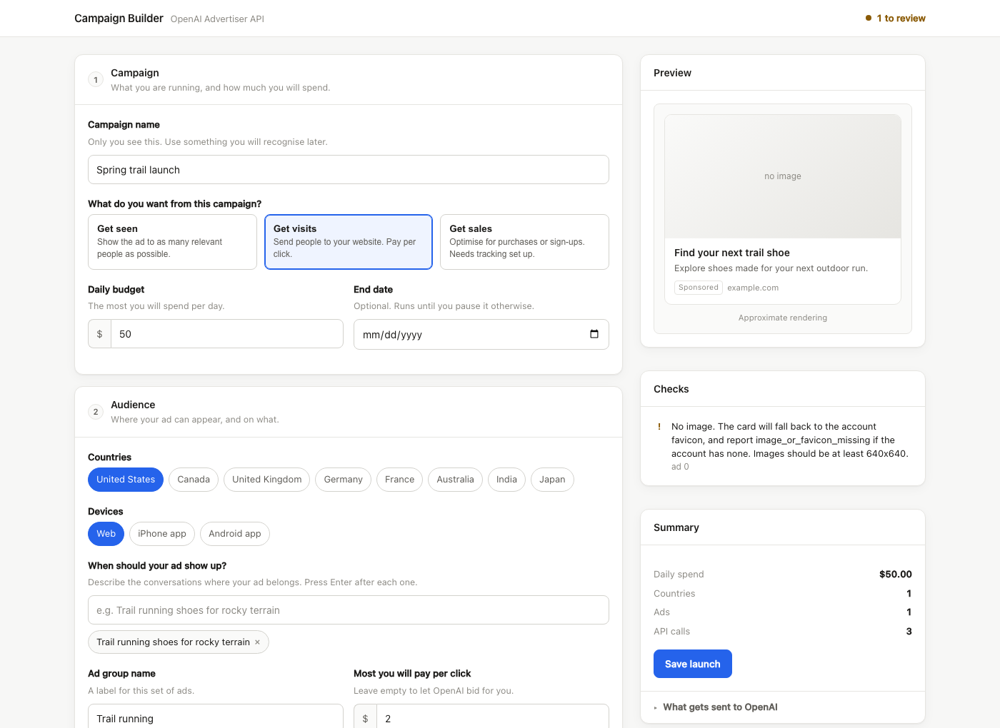
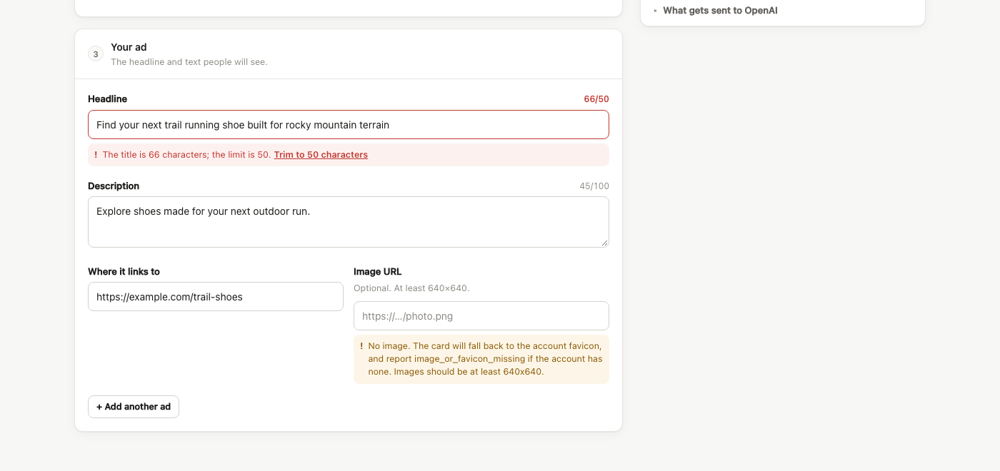

# Campaign Builder

A form that turns a plain-English campaign description into a live campaign on the
[OpenAI Advertiser API](https://developers.openai.com/ads), and catches every
problem before anything is created.



Type, and it checks as you go. Nothing is created until you choose to execute, and
everything is created paused.

---

## Why this exists

Launching a campaign on the Advertiser API is four separate POSTs with nothing
tying them together:

```
POST /campaigns   →  cmpn_123
POST /ad_groups   →  adgrp_123   (needs campaign_id)
POST /upload      →  file_123
POST /ads         →  ad_123      (needs ad_group_id, file_id)
```

Then three activations, then an asynchronous review that decides whether anything
actually serves. There is no transaction and no rollback, so a failure on the third
call leaves the first two real, in the advertiser's account, spending nothing and
explaining nothing.

The API also asks for things an advertiser does not think in. Budgets are integer
**micros** — `$50` is `50000000`. Headlines cap at **50 characters** and body text at
**100**, roughly half what other ad platforms allow. Five separate bidding fields
must agree with each other, but are validated independently, so an illegal
combination returns a generic 400 on whichever call happens to run first.

This app puts a form in front of all of that.

## What it does

**Checks while you type.** Every keystroke recompiles the campaign and returns
structured problems. Each one is attached to the field that caused it, with a
one-click fix where the fix is unambiguous.



**Shows you exactly what will be sent.** Expand *What gets sent to OpenAI* and you
get the literal JSON bodies, in order, before any of them are sent.

**Refuses to do anything unsafe.** Resources are created paused. Activation runs
bottom-up. A half-finished launch resumes instead of starting a second one.

## Running it

```bash
pnpm install && pnpm dev
```

Open <http://localhost:3000>.

**You do not need an API key to use the builder.** Checking a campaign creates
nothing and calls nothing, so the whole form works offline.

To actually create campaigns you need an [ad account](https://ads.openai.com/) and
an Advertiser API key from [Settings](https://ads.openai.com/settings). This is
**not** a `platform.openai.com` key — different service, different base URL.

```bash
echo 'OPENAI_ADS_API_KEY=your-advertiser-key' > .env.local
```

```bash
pnpm test    # 52 tests
pnpm smoke   # end-to-end exercise of the API, no key needed
```

## The API underneath

The form is a client of the same public endpoints anything else would use.

| | |
|---|---|
| `POST /v1/launches` | Brief in, plan and problems out. Creates nothing. Add `?dryRun=1` to skip saving too. |
| `GET /v1/launches/{id}` | The plan, each step's state, and the real resource ids |
| `POST /v1/launches/{id}/execute` | Creates everything, paused |
| `POST /v1/launches/{id}/activate` | Bottom-up activation |
| `GET /v1/launches/{id}/readiness` | Is it delivering, and if not, who fixes it |
| `GET /v1/jobs/{id}` | Step-by-step progress |
| `GET /v1/account` | Currency, timezone, review state |

```
brief → parse → resolve → compile → validate → │ plan + problems │ → execute → activate → reconcile
                 reads      pure       pure      nothing created      saga     bottom-up    owner + verdict
```

## Design decisions

**Compile and execute are separate phases.** Compiling is a pure function — no
clock, no network, no randomness. It cannot spend money or leave a resource behind,
which is why it is safe to run on every keystroke. It also makes the plan hashable,
so execution can refuse a plan that changed after a human reviewed it.

**Problems are data, not exceptions.** A bad brief returns a list of
`{ code, severity, path, message, fix }` alongside a usable plan. `path` is a JSON
pointer, which is what lets the form render each problem against the right input
instead of dumping a wall of text.

**Money converts once.** Amounts enter as dollars and convert to micros in a single
function, which also handles `19.99 * 1e6 = 19989999.999999996`.

**Idempotency keys are derived, not random.** Each is `sha256(reference + stepId)` —
stable across retries and across process restarts, distinct per resource. A create
that times out after succeeding reconciles onto the existing resource rather than
making a twin.

**Everything is created paused.** A half-built launch cannot spend. Activation then
runs ads → ad groups → campaign; the reverse order reports
`campaign_has_no_serving_ready_ad_groups`, a campaign that reads "live" everywhere
and delivers nothing.

**Serving issues carry an owner and a verdict.** `ad_in_review` and `title_missing`
arrive through the same field and mean opposite things. Each code maps to an owner
(`platform` / `billing` / `account` / `advertiser` / `us`) and a verdict (`wait` /
`escalate` / `fix_and_republish`), so the UI can say "nothing to do" instead of
showing red.

## What gets caught before a single call

Taken from the OpenAPI spec in `openapi.snapshot.json`:

| Check | |
|---|---|
| Headline 3–50, body ≤ 100 | with a word-boundary trim offered |
| Budget ≥ 1,000,000 micros | and lifetime ≥ daily |
| Max bid within range | and not denominated in the wrong event |
| Conversions goal | needs a conversion event setting |
| Destination URL | https, publicly reachable, no reserved params (`gclid`, `utm_source`) |
| Currency | must match the ad account — the API does not convert |
| Countries | ISO alpha-2 only, no include/exclude conflicts |
| Schedule | end after start, inside the supported window |
| Copy | claims that reliably fail review, flagged but never blocked |

## Layout

```
app/                 the form and the HTTP surface
src/ads/             typed client: auth, idempotency, rate limits, retries
src/domain/          brief schema, problems, micros
src/compile/         bidding matrix, plan model, the pure compiler
src/validate/        every pre-flight rule
src/execute/         the saga and the activation ladder
src/reconcile/       serving-issue triage
src/store/           in-memory; the one file to replace with a database
```

## Before running this for real

- **`src/store/index.ts` is in-memory.** It is pinned to `globalThis` so it works in
  one process, but it survives neither a redeploy nor a second instance. The schema
  is already relational, so swapping in Postgres touches nothing above that file.
- **Rate-limit buckets are per-instance.** The platform counts 600/endpoint/minute
  and 1,200/minute per ad account *and* per IP. Exact limiting across instances
  means moving the buckets in `src/ads/ratelimit.ts` into Redis.
- **Execution is awaited inside the request.** Fine for a handful of calls. Anything
  larger belongs in a durable queue with the same saga as the worker — the step
  records are already the checkpoint format.
- **Readiness is polled, not pushed.** Review takes hours. Poll on the returned
  backoff, or move it to a scheduled job.

## Licence

MIT
